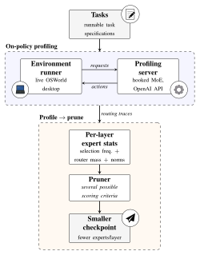

# CUA-OP

Online profiling and pruning for Mixture-of-Experts (MoE) computer-use agents.

A MoE vision-language model drives an agent through desktop tasks. While it
works, it is served by a profiling server that records which experts every token
was routed to and how much each one contributed. Those recordings then decide
which experts to cut from the checkpoint. The statistics therefore come from the
model's own trajectories (on-policy), not from a fixed calibration set.

<p align="center">
  
</p>

## The pieces

| Package | What it does | Depends on |
|---|---|---|
| `moe_profiler` | Hooks the MoE blocks of a Hugging Face VLM and records per-token routing stats. `moe_profiler.server` serves the hooked model behind an OpenAI-compatible API and writes one run per episode. | torch, transformers |
| `moe_pruner` | Scores experts from runs, chooses how many each layer keeps, masks them on a loaded model, or deletes them from a checkpoint. | `moe_profiler` |
| `onpolicy_env` | The CUA side: desktop VMs (`desktop_env`) and agents (`mm_agents`, Holo3 and Qwen), both adapted from OSWorld, plus the runner that drives episodes against the server. | the server's HTTP client only |
| `scripts/`, `demo/` | Complimentary code specific to this repo. | |

`moe_profiler` and `moe_pruner` don't depend on anything CUA-specific and can be
used in other projects. Any client that follows the episode contract (below) can
be profiled.

## Roadmap

- ⬜ Add demonstration code (`demo/`).
- ⬜ Rebase `onpolicy_env`'s desktop environment on OSWorld-V2 instead of OSWorld (V1).

## Setup

Dependencies are managed with [uv](https://docs.astral.sh/uv/) (Python 3.12).
Each role is an extra, so install only what a machine runs:

```bash
uv sync --extra server              # GPU box: the profiling server
uv sync --extra pruner              # wherever the runs are
uv sync --extra env --extra docker  # next to the VMs (vmware/virtualbox need no extra)
```

The other VM providers have their own extras: `aws`, `azure`, `aliyun`,
`volcengine` and `fastvm`. `--extra fla` adds the optional linear-attention
kernels, which speed up `qwen3_5_moe` checkpoints.

torch is held to 2.13 and transformers to 5.15: the hooks were verified bit for
bit on those versions. See `CLAUDE.md` before raising either cap.

## Usage

### 1. Start the profiling server

```bash
uv run moe-profiler-server --port 8000
```

Or with Docker. The checkpoints are mounted, not baked into the image:

```bash
docker build -f Dockerfile.server -t cua-op-server .
docker run --gpus all --rm -p 8000:8000 \
  -v /host/models:/models:ro -v /host/profiler_runs:/data cua-op-server serve
```

The image's commands are `serve`, `prune` and `bench`. The one after the image
name runs with the arguments after it; with none, the image serves.

The server starts with no model loaded. Each episode names the checkpoint it
wants, and the server loads it on demand. `GET /status` shows what is loaded.

### 2. Run episodes

Tasks use the OSWorld format: a `test_all.json` that maps domains to task ids,
plus one JSON config per task. The repo ships no tasks. Task configs are used
for setup only; their `evaluator` sections are ignored.

```bash
# Optional: validate the task set and pre-download its assets.
uv run onpolicy-preflight --test_config_base_dir tasks --test_all_meta_path tasks/test_all.json

uv run onpolicy-run \
  --server_url http://gpu-box:8000 \
  --model_path /models/my-moe-ckpt \
  --runs_root /data/runs/my-moe-ckpt \
  --provider_name docker --agent holo3 --num_envs 4 \
  --test_config_base_dir tasks --test_all_meta_path tasks/test_all.json
```

`--model_path` and `--runs_root` are paths on the server's machine. Each episode
leaves a run there:

```
<runs_root>/<episode>/run.meta.json        model, task and stop reason
<runs_root>/<episode>/run.outputs.jsonl    one line per generation
<runs_root>/<episode>/run_stats/gen_*.npz  routing stats per generation
```

### 3. Prune

`scripts/prune.py` covers the whole stage. It scores the runs, allocates a
budget, writes the plan and, given a checkpoint, cuts it:

```bash
# Score every episode under a runs root, and stop at the plan to inspect it.
uv run scripts/prune.py /data/runs/my-moe-ckpt --criterion msan --fraction 0.5 --out plan.json

# Cut the checkpoint from that plan, then check it against the masked original.
uv run scripts/prune.py --plan plan.json \
  --ckpt /models/my-moe-ckpt --dst /models/my-moe-ckpt-pruned --verify
```

The server image also carries the pruner, as its `prune` command (keep outputs
under the mounts):

```bash
docker run --gpus all --rm -v /host/models:/models -v /host/profiler_runs:/data \
  cua-op-server prune /data/runs/my-moe-ckpt --fraction 0.5 --out /data/plan.json \
  --ckpt /models/my-moe-ckpt --dst /models/my-moe-ckpt-pruned
```

`--domain` and `--stop-reason` choose which episodes are scored. `--save-scores`
caches the scoring pass so you can try other budgets without rescoring
(`--scores`). See `--help` for the full list.

The scoring presets are `easy-ep`, `frequency`, `seer`, `ean`, `reap`, `man` and
`msan`. All are points of a single criterion family; see `moe_pruner/scoring.py`.

## Profiling your own client

The server works with any agent that speaks the OpenAI chat API. Bracket each
episode with `ProfilingClient`, so every generation is attributed to an episode
and a step:

```python
from moe_profiler.server.client import ProfilingClient

client = ProfilingClient("http://gpu-box:8000", "/models/my-moe-ckpt", "/data/runs/x")
client.start("ep-001", task_id="t1", domain="demo")
base_url = client.episode_base_url("ep-001")   # point any OpenAI client here
for step in range(n_steps):
    client.step("ep-001", step)
    ...                                         # chat completions to base_url
client.end("ep-001", stop_reason="done", score=None)
```

This client needs only `requests`, not torch.
